<p align="center">
  
</p>

<h1 align="center">Kyde</h1>

<p align="center">
  <b>A fast, native Git client and side-by-side diff editor for macOS and Linux.</b><br>
  Stage hunks, resolve merge conflicts, browse history and run Claude Code agents across git worktrees — GPU-rendered, written in Rust, no Electron.
</p>

<p align="center">
  <a href="https://kyle-ssg.github.io/kyde/"><b>Website</b></a> · <a href="https://github.com/kyle-ssg/kyde/releases"><b>Download</b></a>
</p>

<p align="center">
  <a href="https://github.com/kyle-ssg/Kyde/actions/workflows/build.yml"></a>
  <a href="https://github.com/kyle-ssg/Kyde/actions/workflows/cargo-deny.yml"></a>
  <a href="LICENSE"></a>
</p>

<p align="center">
  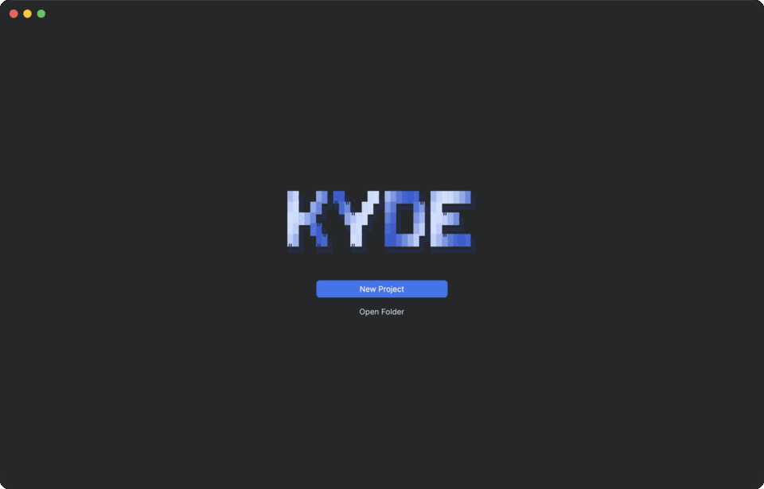
</p>

I don't know Rust.

These days I barely open my full IDE — pre-AI I was doing thousands of commits a year, and now I mostly live in its commit and diff view, one of the few things heavy enough to make me wait for a JVM to start.

So Kyde is just that. A fast native commit and diff code editor — a Git GUI that opens instantly, with the commit view, side-by-side diff, merge tool and git log I used to start a whole IDE for. Prebuilt for macOS and Linux; Windows builds from source.

<p align="center">
  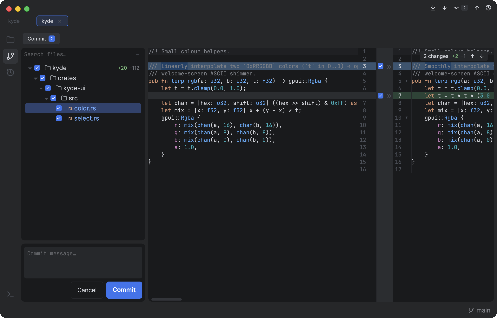
</p>

## Why Kyde

* **Fast.** Native GPU rendering, low latency. 120fps even on large files.
* **Familiar.** A tuned dark theme so it feels at home to anyone who's lived in a modern IDE.
* **Side-by-side diff** with word-level highlighting and a center gutter to stage/revert hunks — `git add -p`, made visual.
* **Open a folder and edit** with tree-sitter highlighting.
* **Run AI agents.** An Agents view for driving many Claude Code agents across projects and worktrees — with everything around them in the same window: GitHub issues and pull requests, reviews, diffs, commits and cleanup.

## Stack

* **gpui** (Apache-2.0) — Zed's native, GPU-rendered GUI framework. No web, no Electron.
* **git**, shelled out. No libgit2.
* **similar** (Apache-2.0) — line and word diffing.

Built from scratch on gpui, borrowing patterns from existing editors but not their code.

## Theme

A hand-tuned dark palette, configurable at runtime via `~/.config/kyde/theme.json`.
Six built-in palettes ship — **Kyde Dark**, **Kyde Light**, and colour-vision-deficiency
variants of each (**Red–Green** and **Blue–Yellow**, which separate the diff/syntax poles
by lightness instead of hue) — switch in Settings.

<p align="center">
  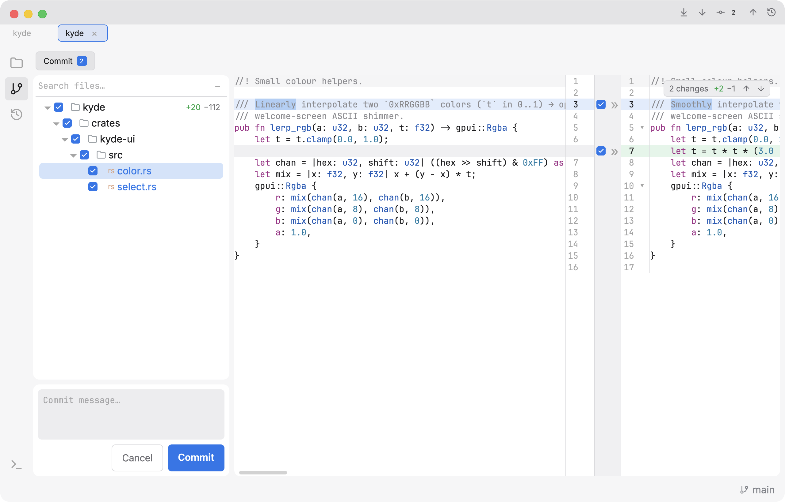
</p>

## Features

### Git client — commit, diff, merge, history

* **Commit view**: changed-files list + an editable side-by-side diff — base on the left, live working copy on the right, both highlighted.
* **Stage / revert** per hunk from the center gutter, or whole files; commit via the message box.
* **Rollback** in a native window — checkbox tree, optional deletion of added files, right-click for diff.
* **Git toolbar** — Fetch, Pull, Commit, Push and History one click away in the title bar, with the behind / changed-file / ahead counts on their buttons.
* **Push / Pull / Fetch** — from the toolbar, the status-bar chips that appear when you're ahead or behind upstream, or the context menu. Push lists the outgoing files as a folder tree before anything leaves.
* **Branch switcher** — searchable tree, `/` as folders, Recent / Local roots, ahead/behind counts per branch.
* **Worktree switcher** — a chip listing every linked worktree with its branch and changed-file count; switching restores that worktree's UI state, and the branch popup jumps to a worktree rather than failing a checkout that's already checked out elsewhere.
* **Compare two files** — ⌘-click two files in the tree → right-click → **Compare Selected** (or right-click a tab → **Compare with Current Tab**) for a side-by-side compare in a native window, with a `«` `»` gutter that applies a hunk in either direction.
* **Merge** — right-click a branch to merge it into the current one. Conflicts open a native two-stage resolver: a conflicts list (what each side did, Accept Yours / Accept Theirs / Merge…), then a 3-pane merge view — yours | result | theirs — with per-change apply/ignore gutters, "apply non-conflicting changes", Compare Contents pairs, and whitespace-ignoring diffs.
* **History** — an IntelliJ-style log: a branches sidebar (HEAD, Local, Remote, `/` as folders) picks what's logged, the commit list draws the branch / merge graph, and the selected commit's changed files open in a read-only diff that compares vs the parent, latest, or your local working tree.
* **Local History** — per-file snapshots independent of git (saves, external changes, and markers before every destructive op). A timeline + snapshot ↔ current diff per file or folder, a changed-since files panel, per-hunk restore, and revert for one file, a folder, or everything since a snapshot — every revert is itself recorded. Configurable retention, clearable, or off entirely.
* **File management** from the tree — New File / Directory / Scratch, Rename (files *and* folders, repointing open tabs across the moved subtree), Delete (with confirm), Cut / Copy / Paste (`⌘X`/`⌘C`/`⌘V`, including files copied in Finder and clipboard image data), drag & drop within the tree or in from Finder, and Reveal in Finder.
* **Non-git folders work too** — file management and editing are plain filesystem ops; git actions hide themselves and offer an **Initialize Git Repository** button instead.
* **Live** — a filesystem watcher (`notify`/FSEvents) refreshes git status and local history when files change outside Kyde, on top of the window-refocus refresh. `.git`-internal churn is filtered so Kyde's own git commands don't spin it.

<p align="center">
  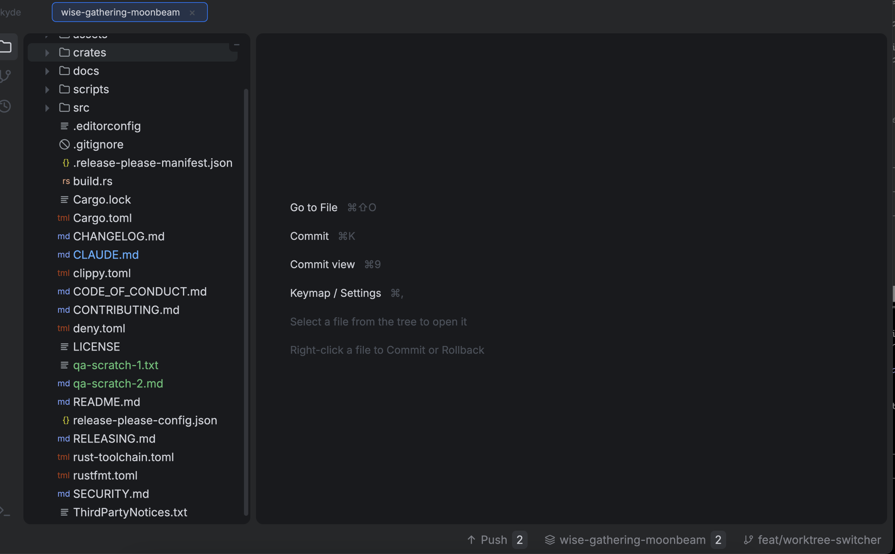
</p>

<p align="center">
  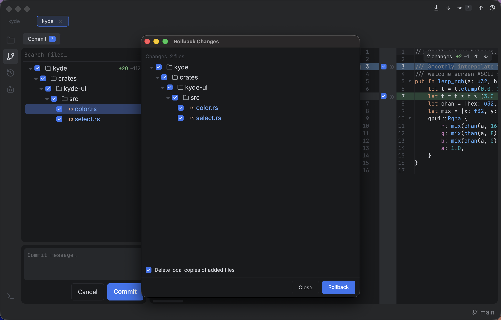
</p>

<p align="center">
  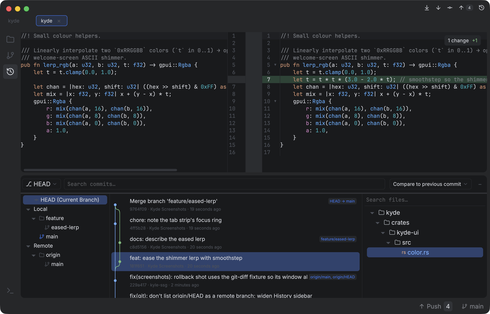
</p>

<p align="center">
  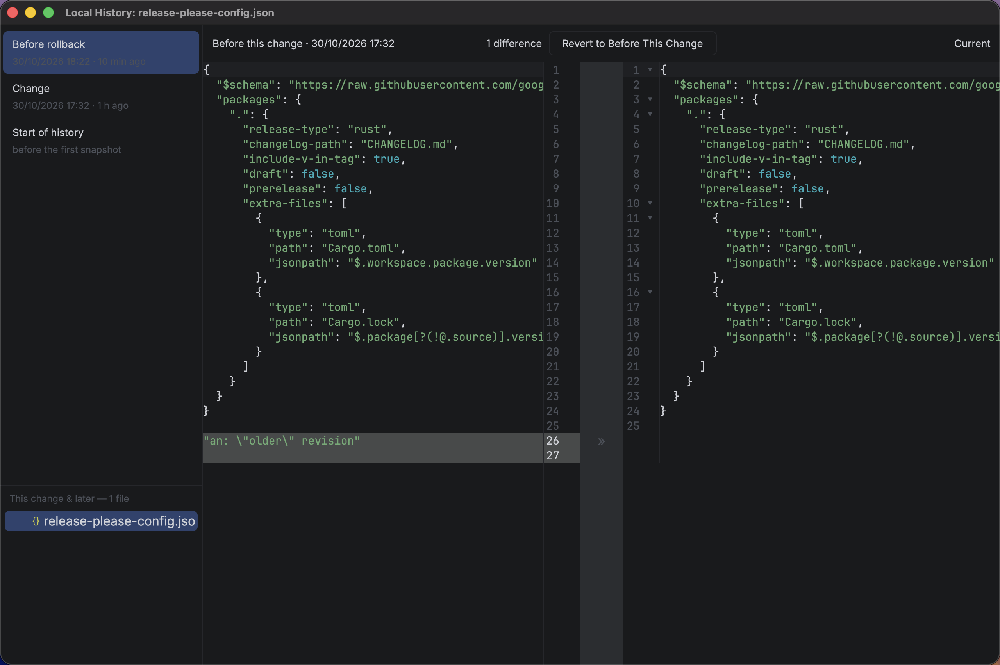
</p>

<p align="center">
  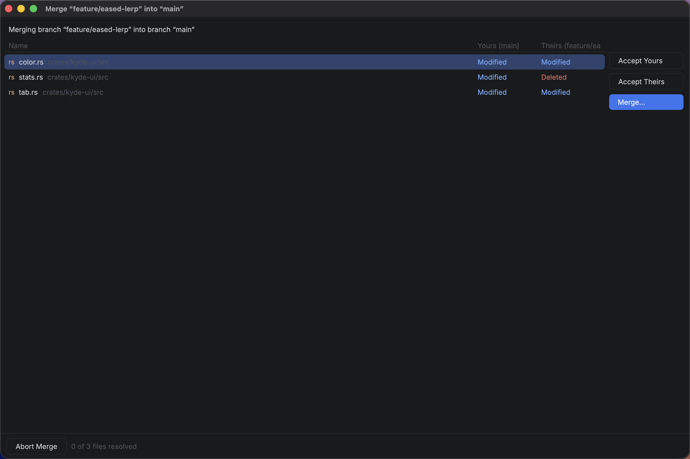
</p>

<p align="center">
  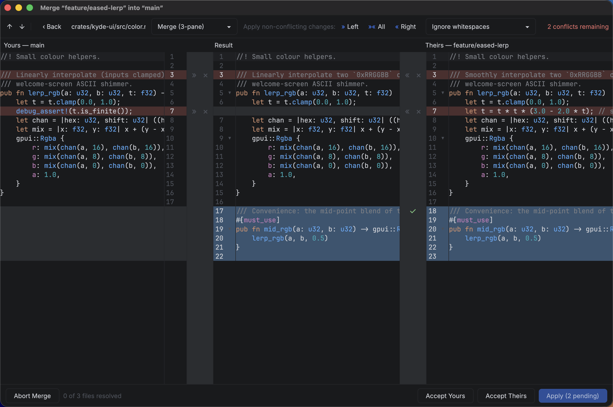
</p>

### Projects

* **Landing view** when no project is open: searchable recents with branch + path, persisted to `~/.config/kyde/projects.json`.
* **Open** / **New Project** via the native folder picker.

### Code editor — browse & edit

* **Folder tree** — expandable, resizable, file-type icons, git-status colors.
* **Text editor** — selection, undo/redo, copy/cut/paste, Tab/Shift-Tab indent, ⌘-backspace, line numbers, current-line highlight, IME, auto-save.
* **Find & replace** — `⌘F` find (`⌘G`/`⇧⌘G` to cycle), `⌘R` replace — in the editor and in every diff (Commit, History, Push, View Diff, Compare, Merge, Local History), with every match highlighted and the current one outlined.
* **Editor tabs** that scroll and follow the active file.
* **Image preview** for PNG/JPG/GIF/WebP/BMP/ICO/AVIF/TIFF.
* **Syntax highlighting** via tree-sitter, installed on demand from a built-in **Language Plugins** manager. Packs: **TypeScript/TSX, JavaScript, Rust, JSON, Markdown, Shell, CSS, SCSS, YAML, TOML, Python, HTML, Go, Java, R, LaTeX** — plus always-on `.env` and `.gitignore` highlighters, and a **Font preview** plugin. Each pack is also a Cargo feature, so a build can ship only the grammars it wants ([details](#build)).
* **Code folding** for grammar-backed languages.
* **Error highlighting** — wavy red squiggles under parse errors, on by default for every installed pack, opt-out per pack.
* **⌘-click navigation** — ⌘-click an import to open the file it points at, a symbol to jump to its definition (same file, or the file it was imported from). Rust, TypeScript/TSX, JavaScript, Python, Java.
* **Sort Lines** (`⌥⌘L`) and **Sort Object Keys** (`⌥⌘S`) — a line sort inside a JSON/JS/TS object delegates to the key sort, so entries move with their commas.
* **Markdown preview** — a live rendered pane alongside the editor.

<p align="center">
  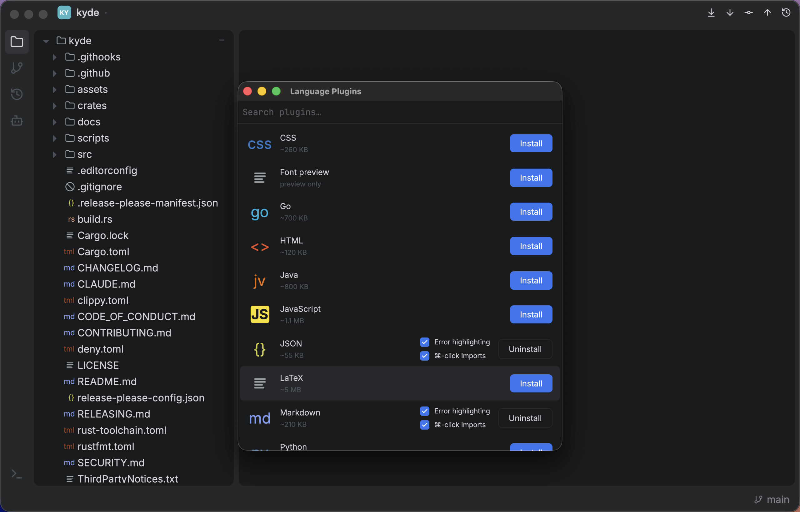
</p>

<p align="center">
  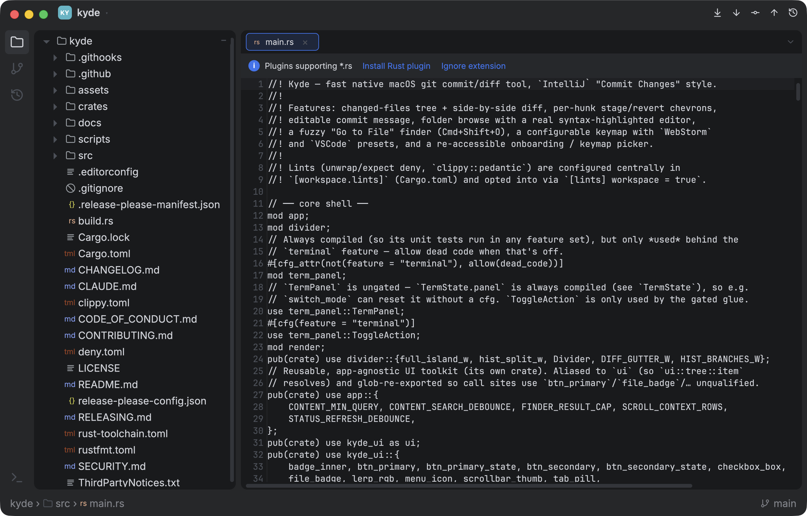
</p>

<p align="center">
  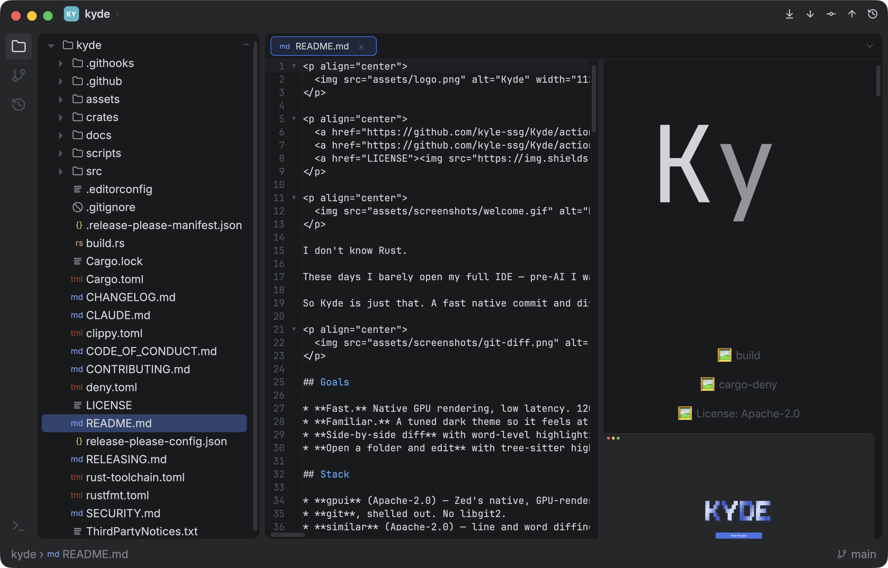
</p>

### Built-in terminal

* **Embedded multi-tab terminal** — a real PTY-backed shell (alacritty's VTE engine),
  bottom-docked, toggled with ``⌃` ``. Full color, scrollback, resize, multiple tabs.
* **Mouse select + copy** (`⌘C`), **paste** (`⌘V`, bracketed-paste aware), **`⌘`-click URLs**.
* History (`↑`), tab-completion, line-editing all work — it's your real shell.
* Optional: drop it entirely with `--no-default-features` (the `terminal` Cargo feature)
  for a ~2MB-lighter binary.

<p align="center">
  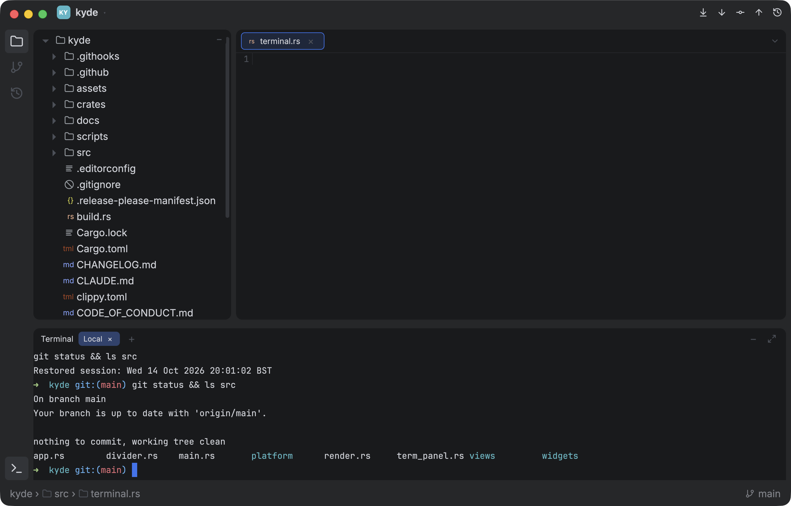
</p>

### Claude Code agents & git worktrees

A home for AI coding agents — Claude Code by default (the start command is configurable). **Projects → worktrees → tabs**, each tab an agent.

* **Projects → worktrees → tabs.** Every project's own checkout plus all of its git worktrees, whoever made them. New worktrees check out from a fresh `origin/main` in seconds, and each one runs one or more agent tabs. Drag to reorder, double-click to rename.
* **New task, new worktree.** Open a tab where work is already going on — another agent, uncommitted changes, unpushed commits — and ask for something unrelated: Kyde tells Claude what's there, Claude moves itself to a fresh worktree off the latest `origin/main`, and the tab follows. Settings → Agents: *Move* (default), *Ask* first, or *Stay*.
* **Live status.** A dot per agent — working (blue), finished while you were away (green, "done"), **needs input** (red — a permission prompt, a question, a plan to approve). It comes from a small Claude Code hook Kyde installs (and can remove) in `~/.claude/settings.json`. A sound and a Dock bounce (on Linux, a desktop notification) when an agent finishes or needs you, `⌘⌥J` to jump to it, and an optional "needs you first" ordering.
* **Agents outlive the window.** Each agent runs in its own background host process: quit Kyde and they keep working; reopen it and they're back, scrollback and all. After a reboot, each tab resumes its exact Claude session.
* **AI titles and context.** Rows are titled by what the agent is doing (Claude Code's own session title), with its task, latest prompt and git state one click away.
* **GitHub built in** (via `gh`). Issues and Pull Requests tabs per project — filter (Mine / All / Unassigned; Review requested / Mine / All) and search. **Start** an issue: a worktree on a `feat/123-short-slug` branch with an agent already briefed. **Review** a PR: it's checked out in its own worktree with a review agent, and Kyde remembers, offering *Re-review* next time. Issues and PRs render like GitHub — the conversation, reviews with their inline threads (reply in place), commits, checks and files changed — and you can comment, close or reopen.
* **Cleans up after itself.** It spots finished work — the PR merged, its changes already on main (squash-merged included), the agent quit, never used, idle, or a quick AI "is this done?" — and, as you choose (Off / Suggest / Auto), closes the tabs or lists them in a **Clean Up** window, which also removes finished worktrees — pre-ticking the tabs it found finished and the worktrees where nothing would be lost.
* **Main stays fresh.** Each project's own checkout fast-forwards to `origin/main` in the background (only on its default branch, only when clean), and agents resuming there start from it.
* **Scriptable.** `ky agent list | read | prompt | send | keys | wait | new | kill` — see and drive agents from the command line, with or without the window open, so agents can watch and drive each other (`ky agent help`).
* **Agents-only mode** hides the IDE around it, for when Kyde is just your agent cockpit. Keyboard shortcuts for all of it (below), scrollback in an editor window (`⌘⌥E`), and per-row display options.
* **Your prompts stand out.** Each message you sent Claude is tinted in the accent colour, `⌘↑` / `⌘↓` jump back and forth between them, and once your last one has scrolled away a pill at the top shows it — click to go back to it.

<p align="center">
  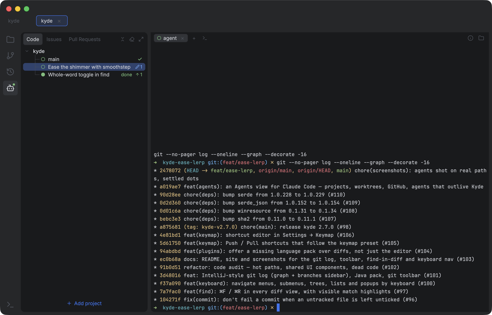
</p>

#### Why it replaced herdr for me

I was running my agents in [herdr](https://herdr.dev), and it's very good at what it does: a terminal workspace built for agents. But my day isn't just terminals. Work starts in a GitHub issue or a review request, an agent's output ends up as a diff I read and commit, and finished worktrees pile up. Next to herdr that meant a browser, an IDE and a git tool open too — and remembering to tidy up.

Kyde puts that whole loop in one native window. Pick an issue or a pull request; one click gives it a fresh worktree and an agent that already knows the job. See at a glance which agents are working, done or waiting on me — and hear about it. Read the diff, commit, push. The finished worktree gets cleared away. Fewer windows, nothing to remember.

herdr still does things Kyde doesn't: it runs anywhere a terminal does (including on remote machines over SSH), splits panes, and works with many agent CLIs. Kyde's Agents view is macOS-first and built around Claude Code.

### Search & navigation

* **Go to File** (`⌘⇧O` / `⌘P`) and **Find Action** (`⌘⇧A`) fuzzy finders.
* **Find in Files** (`⌘⇧F`) — full-text content search across the repo (`git grep`), jump straight to a match.
* **Back / Forward** (`⌘⌥←` / `⌘⌥→`) through visited files, IDE-style.
* **Scratch files** — throwaway buffers under a "Scratches" folder.
* **Breadcrumbs** in the status bar.

<p align="center">
  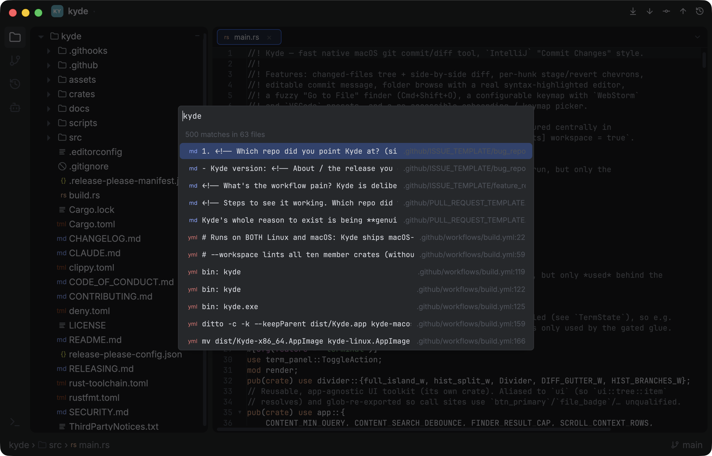
</p>

<p align="center">
  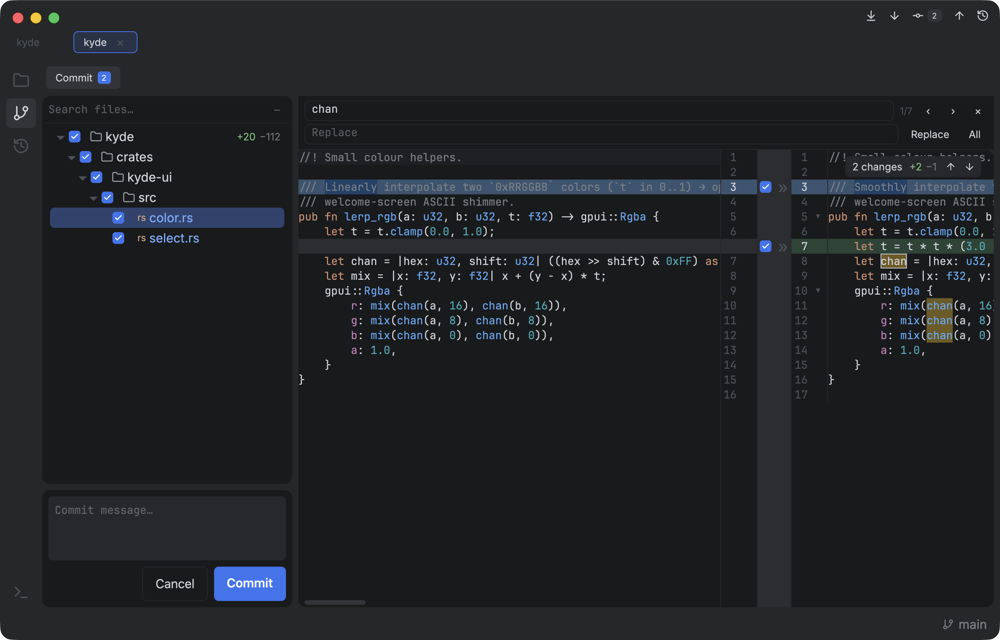
</p>

### Look & feel

* **Islands layout** — rounded panels, draggable dividers, activity rail, native title bar (double-click to zoom), status bar.
* **Native menu bar** — Settings, Plugins, What's New, FPS monitor toggle, Clear Data & Restart, Quit, plus a File menu with Open and Recent Projects (also on the Dock icon's right-click menu). Linux has no app menu bar, so there the same items sit behind a ☰ button: at the right end of the toolbar under the window manager's title bar (X11), at the left of Kyde's own title bar on Wayland.
* **What's New** — the project's GitHub releases mirrored in-app: version list on the left, that release's notes rendered on the right.
* **In-app updates** — a banner when a newer release exists; **Update & Relaunch** downloads and swaps the running `.app` in place (or opens the release page when not running from a bundle).
* **Single instance** — a second `ky <path>` hands the project to the running app as another tab and brings it forward instead of starting a second process (`KYDE_SINGLE_INSTANCE=0` opts out).
* **App icon** from the bundled logo.

### Keymap & configuration

* **WebStorm** / **VSCode** presets, and a **shortcut editor** in Settings → Keymap: click a shortcut and press the new keys (a key already in use moves over, and the action it came from is named), reset one action, or **Reset to WebStorm / IntelliJ defaults**. Saved to `~/.config/kyde/keymap.json`.
* **Onboarding keymap picker** on first launch, reopenable via Settings.
* **Keyboard navigation** everywhere — context menus and their submenus, the file trees, lists and popups: `↑` / `↓` move, `←` / `→` fold folders or step in and out of submenus, `⏎` activates, space ticks a checkbox, `⇧F10` opens a row's context menu, `Esc` closes.
* **Install shell command** — optionally symlinks `ky` into `~/.local/bin`. No shell-rc editing, no sudo.

## Install

Grab the latest build for your platform from the [Releases](../../releases) page.

**macOS** — download `kyde-macos.zip` (Apple Silicon) or `kyde-macos-x86_64.zip` (Intel), unzip, and drag **Kyde.app** to `/Applications`.

**Linux** — download `kyde-linux-x86_64.AppImage`, `chmod +x` it, and run it. It needs glibc 2.39+ (Ubuntu 24.04, Linux Mint 22 or newer) and a Vulkan driver; a stock Ubuntu desktop already has the rest. On a minimal install: `sudo apt install libvulkan1 mesa-vulkan-drivers libxkbcommon-x11-0 libwayland-client0 fuse3` (NVIDIA's driver brings its own Vulkan).

On X11 the window manager draws Kyde's title bar; on a Wayland desktop that leaves that to the app (GNOME), Kyde draws its own — drag it to move, double-click to maximize, minimize / maximize / close at its right. On X11 Kyde follows the desktop's scale (`Xft.dpi`, which GNOME, Cinnamon and KDE set); to override it, start Kyde with `GPUI_X11_SCALE_FACTOR=1.5` (any factor), or `GPUI_X11_SCALE_FACTOR=randr` to use the monitor's physical DPI. Wayland uses each monitor's own scale.

## Usage

Launch with no arguments for the Projects view, or point it at a repo:

```sh
cargo run -- /path/to/repo
```

First-run setup offers to **install a `ky` shell command** (a symlink into `~/.local/bin` — no shell-rc editing, no `sudo`; from the AppImage it links the `.AppImage` file, so keep that where it is); leave it ticked and you can open Kyde from any terminal. On Ubuntu, `~/.local/bin` only joins your `PATH` at login if it already existed, so if Kyde had to create it, log out and back in once.

```sh
ky                 # Projects view
ky /path/to/repo   # open a repo directly
```

Default shortcuts (WebStorm → VSCode):

* Go to File: `⌘⇧O` → `⌘P`
* Find Action: `⌘⇧A`
* Find in Files: `⌘⇧F`
* Find / Replace (file or diff): `⌘F` / `⌘R` (`⌘G` / `⇧⌘G` to cycle)
* Save: `⌘S`
* Commit: `⌘K` → `⌘⏎`
* Commit view: `⌘9` → `⌃⇧G`
* Push / Pull: `⌘⇧K` / `⌘T` → unbound (VSCode has no defaults; set them in Settings → Keymap)
* Browse view: `⌘1` → `⌘⇧E`
* Back / Forward: `⌘⌥←` / `⌘⌥→`
* Sort Lines / Sort Object Keys: `⌥⌘L` / `⌥⌘S`
* New Scratch: `⌘⇧N`
* Toggle terminal: ``⌃` ``
* Settings: `⌘,`
* Agents: next / previous agent `⌘⌥↓` / `⌘⌥↑`, the one that needs you `⌘⌥J`, the Nth `⌃1`–`⌃9`, next / previous tab `⌘⇧]` / `⌘⇧[`, new worktree `⌘⌥N`, rename tab `F2`, scrollback in an editor `⌘⌥E`, jump between your prompts `⌘↑` / `⌘↓`, hide the sidebar `⌘⌥B`

On Linux (and Windows) `⌘` is **Ctrl** and `⌥` is **Alt**: Save is `Ctrl+S`, Go to File `Ctrl+Shift+O`, Settings `Ctrl+,`, ⌘-click is Ctrl+click, and Settings → Keymap shows every key that way. A few keys differ there:

* Find next / previous: `F3` / `Shift+F3`
* Editor: `Ctrl+←` / `Ctrl+→` move by word and `Ctrl+Backspace` deletes one (Home / End go to the line ends)
* The Nth agent: `Alt+1`–`Alt+9`
* Terminal: Ctrl + a letter goes to the shell (`Ctrl+C` interrupts, `Ctrl+W` deletes a word), so the terminal's own keys take Shift: copy / paste `Ctrl+Shift+C` / `Ctrl+Shift+V`, new / close tab `Ctrl+Shift+T` / `Ctrl+Shift+W`, jump between your prompts `Ctrl+Shift+↑` / `Ctrl+Shift+↓` (the shell's own `Ctrl+L` / `Ctrl+U` clear)

* Keys the desktop keeps (Cinnamon and GNOME switch workspaces on `Ctrl+Alt+←/→/↑/↓`, Cinnamon locks the screen on `Ctrl+Alt+L`) and keys that need a US layout move: Back / Forward `Alt+←` / `Alt+→`, next / previous agent `Ctrl+Alt+PageDown` / `Ctrl+Alt+PageUp`, next / previous agent tab `Ctrl+PageDown` / `Ctrl+PageUp`, Sort Lines `F9`

A shortcut written with Shift and a symbol binds to what that key types on your keyboard layout, read from the active layout and again whenever you switch.

## Build

Needs Rust 1.96+ and (on macOS) Apple's Metal Toolchain, which gpui uses to compile its shaders — if a clean machine errors with "missing Metal Toolchain", run `xcodebuild -downloadComponent MetalToolchain`.

On Linux, gpui needs its backend's dev libraries first (Ubuntu/Debian — the same list CI installs):

```sh
sudo apt install pkg-config libssl-dev libzstd-dev libwayland-dev libxkbcommon-dev \
  libxkbcommon-x11-dev libfontconfig-dev libfreetype-dev libx11-dev libxcb1-dev \
  libvulkan-dev clang cmake
```

```sh
cargo build --release             # full — every language grammar baked in (default)
cargo test --workspace            # logic, perf guards, and headless-gpui smoke tests
```

`--workspace` matters: the root package is the binary, so a bare `cargo test` skips the
library crates under `crates/` where most of the logic tests live.

Each language pack is a Cargo feature, so unused grammars can be dropped from the binary entirely (smaller image + resident RAM):

```sh
cargo build --release --no-default-features --features rust,json,toml
```

`./scripts/bundle-linux.sh` wraps the release build in an AppImage (`dist/Kyde-x86_64.AppImage`), the same way `./scripts/bundle-macos.sh` makes `dist/Kyde.app`.

## Performance

Large files stay smooth via **viewport virtualization** (only on-screen rows are shaped each frame) and **async highlighting** (big files open instantly as plain text, then highlight off-thread). A 37k-line `package-lock.json` scrolls at ~120fps.

<p align="center">
  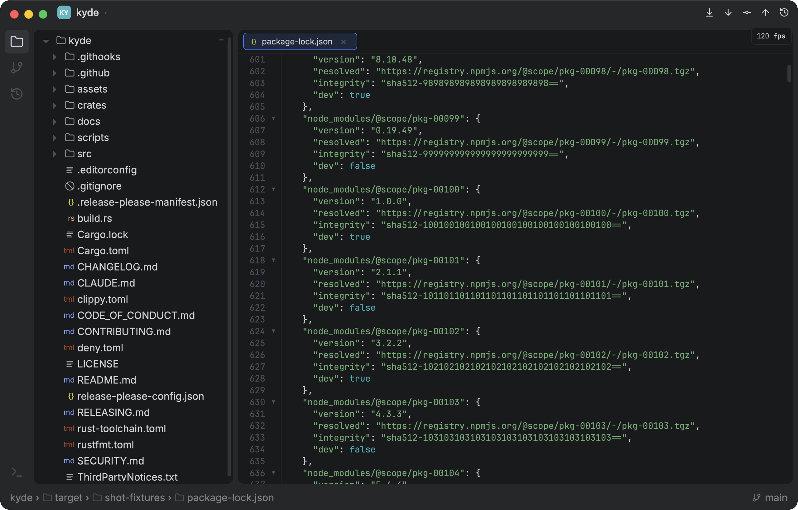
</p>

Guarded by `perf_*` time-budget tests, headless-gpui smoke tests (render every screen, fail on any panic), and a toggleable on-screen FPS monitor.

## Known limitations / next

* **Prebuilt releases are macOS + Linux.** I develop on macOS, so the signed + notarized macOS build is the one I test myself; the Linux AppImage (x86_64) was revived and tested by a contributor on Ubuntu — Linux bug reports are welcome. It doesn't self-update: the update banner's **Download** opens the release page. Windows packaging still isn't wired into the release — re-enabling it is a **good first issue** for a contributor who runs Windows. Until then, Windows users can `cargo build --release`.
* No soft-wrap in the file editor (long lines scroll horizontally; the commit box does wrap). The editor holds a flat `String` and undo is whole-buffer snapshots — a rope-based buffer comes later for very large edits.
* No scrollback search in the terminal (open it in an editor with `⌘⌥E` and `⌘F` there).
* Agents' needs-input / done states come from a Claude Code hook; other agent CLIs get a simpler dot based on their output.

## FAQ

**Is Kyde free and open source?**
Yes — Apache-2.0. Free to use, modify and redistribute.

**Is it an Electron or web app?**
No. It's native and GPU-rendered on [gpui](https://gpui.rs), the Rust UI framework behind Zed, and it drives the real `git` binary — no libgit2, no bundled browser.

**Does it run on Windows?**
Not as a prebuilt download yet. `cargo build --release` works; packaging it is a good first issue (see [Known limitations](#known-limitations--next)).

**Does it replace my IDE?**
It replaces the part I kept opening one for: commit, diff, merge, history and quick edits — with tree-sitter highlighting, folding, error squiggles and ⌘-click navigation. There's no language server, so no autocomplete or refactoring.

**Which AI coding agents does it work with?**
Claude Code by default, with live working / done / needs-input status from a hook Kyde installs. The start command is configurable, so other agent CLIs run too, with a simpler status dot.

## Contributing

If you open a PR, please be kind — explain the idiomatic way, don't just dunk on my `.clone()`s. I'll read every comment and quietly Google what a lifetime is.

If the feature adds a lot of bloat, it should be a plugin.
