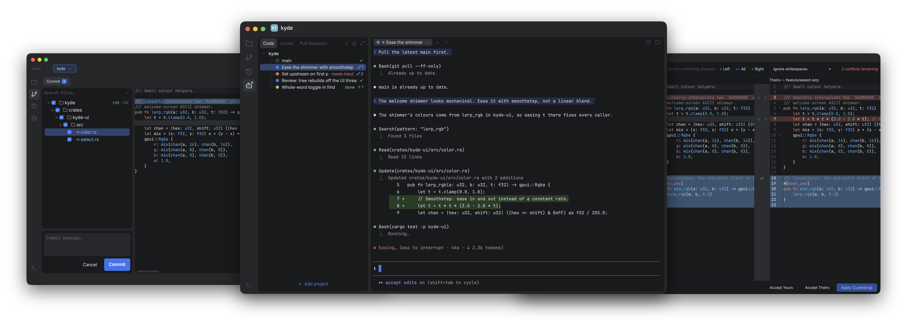
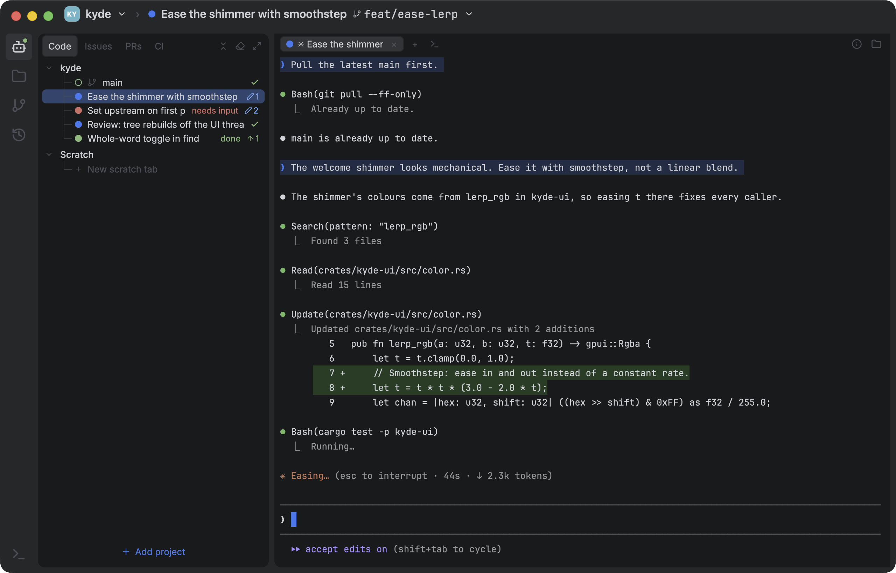
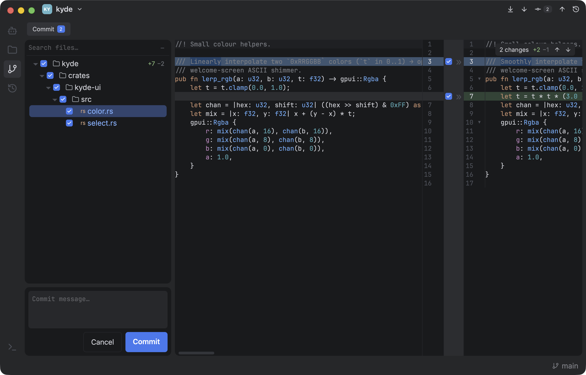
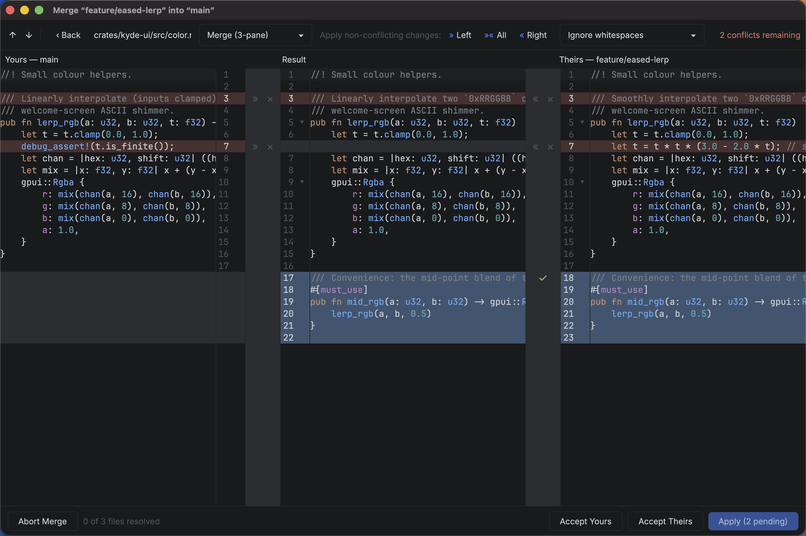
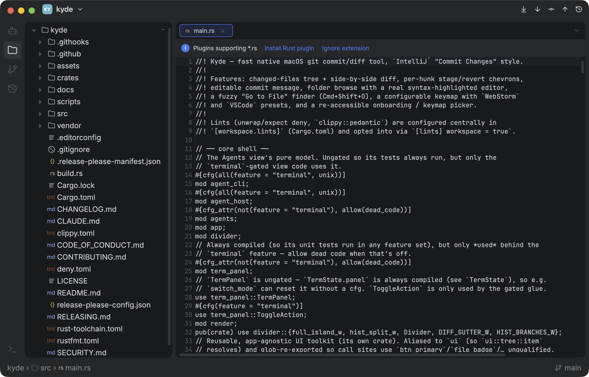

<p align="center">
  
</p>

<h1 align="center">Kyde</h1>

<p align="center">
  <b>A fast, native IDE and Git client built around your coding agents.</b><br>
  Run many Claude Code agents side by side, each in its own git worktree with live status. Then review what they wrote in a side-by-side diff, stage it hunk by hunk, resolve conflicts in a 3-way merge and commit. GPU-rendered, written in Rust, no Electron. macOS and Linux.
</p>

<p align="center">
  <a href="https://kyle-ssg.github.io/kyde/"><b>Website</b></a> · <a href="https://github.com/kyle-ssg/kyde/releases"><b>Download</b></a>
</p>

<p align="center">
  <a href="https://github.com/kyle-ssg/Kyde/actions/workflows/build.yml"></a>
  <a href="https://github.com/kyle-ssg/Kyde/actions/workflows/cargo-deny.yml"></a>
  <a href="LICENSE"></a>
</p>

<p align="center">
  
</p>

I don't know Rust.

Pre-AI I was doing thousands of commits a year from a full IDE. Now agents write most of the code, and my day is starting them, keeping track of which one needs me, and checking what they wrote before it lands. I was still doing that last part in the IDE's commit and diff view, one of the few things heavy enough to make me wait for a JVM to start.

So Kyde is that day in one app that opens instantly: agents in their own worktrees, with the commit view, side-by-side diff, 3-way merge and editor one click away.

## Why Kyde

* **Many agents, no collisions.** Each agent gets its own git worktree and branch, so parallel agents never trample each other's files. Live status shows which one is working, done, or waiting on you.
* **Issue to merged in one place.** Start a GitHub issue or review a PR and get a fresh worktree with an agent already briefed. Review its diff, stage hunks, commit and push, and Kyde cleans the worktree up once the work lands.
* **IDE-grade diff and merge.** An IntelliJ-style commit view with a side-by-side, word-level diff and per-hunk staging, a 3-way merge resolver, a history graph and local history, plus an editor for the fix you'd rather make yourself.
* **Instant.** Native and GPU-rendered on [gpui](https://gpui.rs), the framework behind Zed. No JVM, no Electron. It opens in a blink and scrolls a 37k-line file at 120fps.

## What it does

### Agents

A home for Claude Code (or any agent CLI): projects → worktrees → tabs, each tab an agent.

* **Live status** — working, done, or needs you, with a sound when one finishes and a key to jump to it.
* **Issue to agent in one click** — start a GitHub issue or review a PR and get a fresh worktree with an agent already briefed.
* **GitHub in the sidebar** — issues and PRs render in-app with comments, commits, changed files and checks. Comment or close without opening a browser.
* **New task, new worktree** — ask a busy agent for something unrelated and it moves itself to a clean worktree.
* **Outlives the window** — quit Kyde and agents keep working; reopen and they're back.
* **Cleans up** — spots merged or finished work and closes its tabs and worktrees.
* **Scriptable** — `ky agent …` drives agents from the shell, so agents can drive each other.
* **Agents only** — hide the rest of the IDE when the agents are all you need. One click opens a worktree in the editor.

<p align="center">
  
</p>

### Git: side-by-side diff and 3-way merge

* **Commit** — changed files beside an editable side-by-side diff with word-level highlighting. Stage or revert any hunk from the center gutter: `git add -p`, made visual.
* **Merge** — a conflicts list, then a 3-pane yours | result | theirs resolver that applies the non-conflicting changes in one click.
* **History** — branches sidebar, commit graph, and each commit's diff against its parent, the latest, or your working tree.
* **Local History** — snapshots independent of git, taken on save and before every destructive action, with per-hunk restore.
* **The rest** — push, pull and fetch from the toolbar, branch and worktree switchers, rollback, and compare any two files.

<p align="center">
  
</p>

<p align="center">
  
</p>

### IDE

* Folder tree, tabs, file management, and fuzzy Go to File, Find Action and Find in Files.
* Tree-sitter highlighting for 16 languages, installed on demand, with folding, error squiggles and ⌘-click to definition.
* Markdown and image preview, and a built-in terminal. Drop a file on it, or on an agent, to paste its path.
* WebStorm or VSCode keymap, and an IDE-style dark theme (plus light and colour-blind palettes).

<p align="center">
  
</p>

## Install

Grab the latest build from [Releases](../../releases).

* **macOS** — `kyde-macos.zip` (Apple Silicon) or `kyde-macos-x86_64.zip` (Intel). Unzip and drag **Kyde.app** to `/Applications`.
* **Linux** — `kyde-linux-x86_64.AppImage`. `chmod +x` it and run it. Needs glibc 2.35+ (Ubuntu 22.04 or newer) and a Vulkan driver.

First launch offers to install a `ky` command: `ky` opens your projects, `ky /path/to/repo` opens a repo.

## Build

```sh
cargo build --release
cargo test --workspace
```

Needs Rust 1.96+. On macOS, gpui also needs Apple's Metal Toolchain (`xcodebuild -downloadComponent MetalToolchain`). On Linux, install the dev libraries first:

```sh
sudo apt install pkg-config libssl-dev libzstd-dev libwayland-dev libxkbcommon-dev \
  libxkbcommon-x11-dev libfontconfig-dev libfreetype-dev libx11-dev libxcb1-dev \
  libvulkan-dev clang cmake
```

Each language is a Cargo feature, so a smaller build can leave grammars out: `cargo build --release --no-default-features --features rust,json,toml`.

## FAQ

**Which AI coding agents does it work with?**
Claude Code by default, with live status from a hook Kyde installs. The start command is configurable, so other agent CLIs run too, with a simpler status dot.

**Does it replace my IDE?**
It replaces what I still opened one for once agents started writing the code: reviewing, committing, merging and quick edits. There's no language server, so no autocomplete or refactoring. The agents do that part.

**Is Kyde free and open source?**
Yes — Apache-2.0.

**Does it run on Windows?**
Not as a download yet, but `cargo build --release` works. Packaging it is a good first issue.

## Contributing

If you open a PR, please be kind — explain the idiomatic way, don't just dunk on my `.clone()`s. I'll read every comment and quietly Google what a lifetime is.

If the feature adds a lot of bloat, it should be a plugin.
